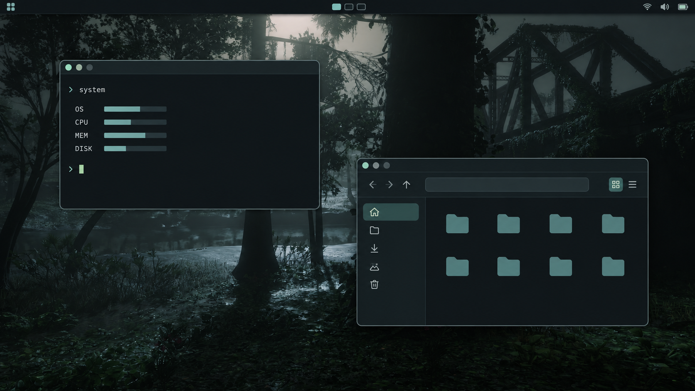

# BlueSage

A dark Omarchy theme with cool blue text, muted sage and teal accents, and a misty forest background.

## Preview



This is an illustrative mockup using the included wallpaper, not a live screenshot.

## Install

```sh
omarchy theme install https://github.com/Squiggleshock/bluesage-omarchy-theme.git
```

## Contents

- `colors.toml` — theme palette
- `backgrounds/original.png` — included wallpaper
- `icons.theme` — uses the Yaru-blue icon theme
- `btop.theme` — btop color theme
- `templates/btop.theme.tpl` and `render-theme.py` — local source and renderer for the btop theme file

To regenerate `btop.theme` after editing the palette, run `python3 render-theme.py`.

## Licensing and attribution

GPL V3
